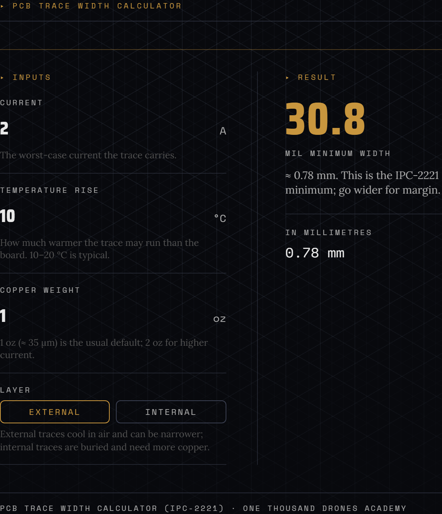
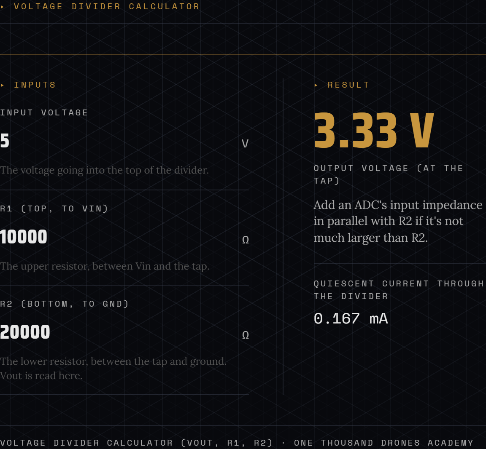
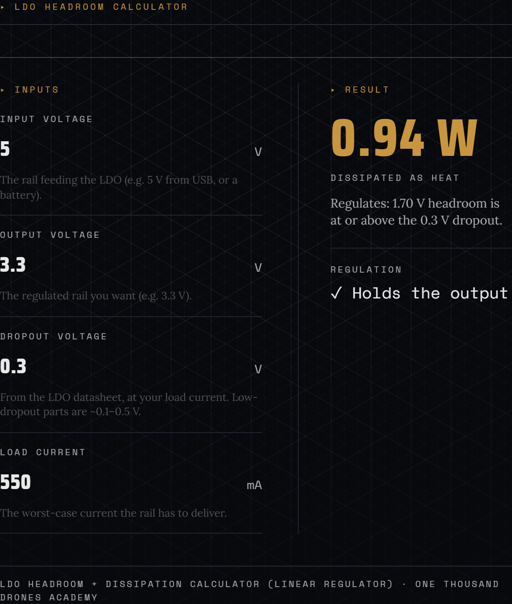

# OTD EE Calculators

Tested, dependency-free TypeScript math for nine common electronics calculations:
battery runtime, addressable-LED supply sizing, LED series resistors, voltage
dividers, linear-regulator headroom, RC filter cutoffs, PCB trace width, resistor
power, and battery pack energy. This is the same math that drives the live
calculators at the [One Thousand Drones Academy tools page](https://academy.onethousanddrones.com/tools),
pulled out so you can use it directly or check the numbers.

[](./LICENSE)

[](https://academy.onethousanddrones.com/tools/pcb-trace-width)

<p>
  <a href="https://academy.onethousanddrones.com/tools/voltage-divider"></a>
  <a href="https://academy.onethousanddrones.com/tools/ldo-headroom"></a>
</p>

<sub>The live, interactive calculators on the One Thousand Drones Academy. The math in this repo drives them; click any shot to try it.</sub>

Every function takes already-validated scalars and returns a number, throwing on
physically meaningless input (a zero or negative current, capacity, or
resistance) so a divide-by-zero never reaches your UI as `Infinity` or `NaN`. The
worked examples on the Academy pages are computed from these exact functions, so
the prose there can never drift from the math here.

## Install

The package is headed for npm. Until then, clone the repo or copy
[`src/calculators.ts`](./src/calculators.ts) straight into your project (it has no
dependencies).

```bash
git clone https://github.com/Otd-llc/ee-calculators
```

```ts
import {
  lipoRuntimeHours,
  ipc2221TraceWidthMil,
  packWh,
} from "@onethousanddrones/ee-calculators";

// A 2000 mAh pack at 100 mA average, 80% usable -> 16 hours
lipoRuntimeHours({ capacityMah: 2000, averageCurrentMa: 100, usablePct: 80 });

// 2 A, 10 °C rise, 1 oz outer copper -> about 31 mil minimum width
ipc2221TraceWidthMil({ currentA: 2, tempRiseC: 10, copperOz: 1, external: true });

// A 3S2P pack of 3000 mAh / 3.7 V cells -> 66.6 Wh
packWh({ capacityMah: 3000, nominalV: 3.7, series: 3, parallel: 2 });
```

## The calculators

Each one has a live, interactive version and an embeddable widget on the Academy.

| Calculation | Functions | Live calculator | Embed |
| --- | --- | --- | --- |
| LiPo / Li-ion runtime | `lipoRuntimeHours`, `formatRuntime` | [LiPo battery runtime](https://academy.onethousanddrones.com/tools/lipo-battery-runtime) | [embed](https://academy.onethousanddrones.com/embed/lipo-battery-runtime) |
| WS2812 / NeoPixel supply | `ws2812SupplyMilliamps`, `ws2812RecommendedSupplyAmps` | [WS2812 power supply](https://academy.onethousanddrones.com/tools/ws2812-power-supply) | [embed](https://academy.onethousanddrones.com/embed/ws2812-power-supply) |
| LED series resistor | `ledSeriesResistorOhms`, `ledResistorPowerMw`, `nextE24Up` | [LED series resistor](https://academy.onethousanddrones.com/tools/led-series-resistor) | [embed](https://academy.onethousanddrones.com/embed/led-series-resistor) |
| Voltage divider | `voltageDividerOut`, `voltageDividerCurrentMa` | [Voltage divider](https://academy.onethousanddrones.com/tools/voltage-divider) | [embed](https://academy.onethousanddrones.com/embed/voltage-divider) |
| LDO headroom + dissipation | `ldoHeadroomV`, `ldoHolds`, `ldoDissipationW` | [LDO headroom](https://academy.onethousanddrones.com/tools/ldo-headroom) | [embed](https://academy.onethousanddrones.com/embed/ldo-headroom) |
| RC filter cutoff | `rcCutoffHz` | [RC filter cutoff](https://academy.onethousanddrones.com/tools/rc-filter-cutoff) | [embed](https://academy.onethousanddrones.com/embed/rc-filter-cutoff) |
| PCB trace width (IPC-2221) | `ipc2221TraceWidthMil`, `milToMm` | [PCB trace width](https://academy.onethousanddrones.com/tools/pcb-trace-width) | [embed](https://academy.onethousanddrones.com/embed/pcb-trace-width) |
| Resistor power + wattage | `resistorPowerW`, `recommendResistorWattage` | [Resistor power](https://academy.onethousanddrones.com/tools/resistor-power) | [embed](https://academy.onethousanddrones.com/embed/resistor-power) |
| Battery pack watt-hours | `cellWh`, `packWh`, `packVoltage`, `packCapacityMah` | [Battery watt-hours](https://academy.onethousanddrones.com/tools/battery-watt-hours) | [embed](https://academy.onethousanddrones.com/embed/battery-watt-hours) |

## Embed a live calculator

Each calculator can be dropped into any page as an iframe. Copy the snippet from
the tool page (the "Embed this calculator" block), or build it yourself:

```html
<iframe src="https://academy.onethousanddrones.com/embed/pcb-trace-width"
  title="PCB trace width calculator" loading="lazy"
  style="width:100%;border:0" height="560"></iframe>
<p><a href="https://academy.onethousanddrones.com/tools/pcb-trace-width">PCB trace width calculator · One Thousand Drones Academy</a></p>
```

The widget posts its height to the parent, so the snippet on the tool page also
includes a small resize listener if you want the frame to fit exactly.

## Where the numbers come from

The constants and curves are from primary sources, not folklore:

- **WS2812 full white = 60 mA/pixel** — the XINGLIGHT XL-5050RGBC-WS2812B and
  Adafruit NeoPixel worst case (three ~20 mA channels at once).
- **PCB trace width** — the IPC-2221 current-capacity curve
  (`I = k · ΔT^0.44 · A^0.725`), with `k = 0.048` external / `0.024` internal and
  1 oz copper ≈ 1.378 mil thick.
- **E24 resistor values** — IEC 60063.
- **Resistor wattage** — the recommended part is the smallest standard rating at
  twice the dissipation, since a resistor run at its rating sits near its maximum
  temperature.

The full explanations, worked examples, and citations live on each
[Academy tool page](https://academy.onethousanddrones.com/tools).

## Develop

```bash
npm install
npm test      # vitest, ~40 cases covering the math and the input guards
npm run build # tsc -> dist/
```

## License

MIT. See [LICENSE](./LICENSE). Built by [One Thousand Drones](https://onethousanddrones.com).
